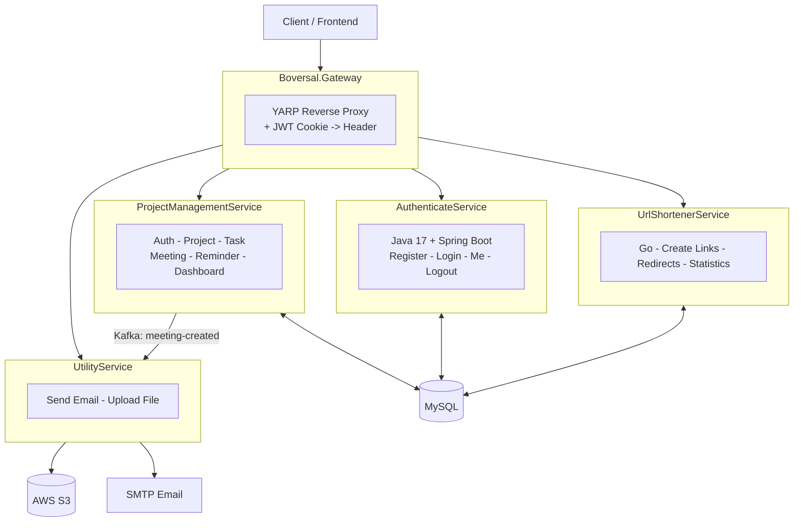

# Boversal Backend

### Project & Task Management System — Microservices Architecture


---

## Infrastructure (Terraform)

The AWS infrastructure for this backend is provisioned as code with **Terraform**, and is maintained in a separate repository:

👉 **[boversal-infrastructure](https://github.com/LeHuyVuu/boversal-infrastructure)**

That repository defines the AWS resources used by the AWS deployment option (Elastic Load Balancer, Auto Scaling Group, and EC2 instances running the Docker Compose stack), so the environment can be created, updated, and torn down reproducibly instead of being configured by hand in the AWS console.

---

## What does this project do?

**Boversal** is the backend for a platform similar to a lightweight **Trello + Google Calendar**:

| Feature | Description |
|---|---|
| Project Management | Create projects, add members, track status |
| Task Management | Kanban-style, assignees, deadlines, priority |
| Meetings | Schedule meetings, automatically send invitation emails to attendees |
| Reminders | Automatically send email reminders at the scheduled time |
| Comments & Attachments | Discussion per task/project, file upload to S3 |
| Login/Registration | JWT-based authentication |
| URL Shortener | Public short links with optional aliases, expiry, and click statistics |

---

## Architecture Overview



---

## Role of Each Service

<table>
<tr>
<td width="33%" valign="top">

### AuthenticateService
**Dedicated Java authentication service**

- Built with Java 17 and Spring Boot
- Provides register, login, current-user, logout, and health APIs
- Uses vertical slice architecture, with one folder per API
- Shares the MySQL `user` table with `ProjectManagementService`
- Uses JWT tokens and HTTP-only `jwt` cookies
- Uses ASP.NET Identity-compatible PBKDF2 password hashing
- Validates and persists users through JPA without changing the existing database schema

The service is available through the gateway under `/authenticate-service`.

### Gateway
**Single entry point**

- Routes requests to the correct service
- Converts the `jwt` cookie into an `Authorization` header
- Exposes a `/health` endpoint

</td>
<td width="33%" valign="top">

### ProjectManagement
**Core business logic**

- Auth, User, Project, Task
- Meeting, Reminder, Dashboard
- Publishes a Kafka event when a Meeting is created
- Persists data in MySQL

</td>
<td width="33%" valign="top">

### Utility
**Supporting service**

- Listens to Kafka to send meeting invitation emails
- Sends emails directly via API
- Uploads files/images to AWS S3

</td>
</tr>
</table>

### UrlShortenerService

**Public URL shortening service written in Go**

- Creates short links with optional custom aliases and expiration times
- Redirects visitors and records click counts and last-click timestamps
- Uses the existing MySQL database and is available through the gateway under `/shortener-service`
- Does not require authentication; link creation and statistics are public

API examples:

```http
POST /shortener-service/api/links
Content-Type: application/json

{
  "url": "https://example.com/a-long-page",
  "alias": "example",
  "expiresAt": "2027-01-01T00:00:00Z"
}
```

The response includes a `shortPath`, such as `/shortener-service/r/example`. Open that path to redirect to the original URL. Read public click statistics with `GET /shortener-service/api/links/{code}/stats`. Only `http` and `https` target URLs are accepted.

The service reads the same .NET-style `DATABASE_URL` environment variable as the other services and creates its `short_links` table at startup.

---

## Main Technologies

| Category | Technology |
|---|---|
| Language / Platform | C# / .NET 8 |
| Code Architecture | Clean Architecture, CQRS (MediatR), FluentValidation |
| Database | MySQL with EF Core |
| Asynchronous Communication | Apache Kafka |
| Authentication | JWT |
| File Storage | AWS S3 |
| Containerization | Docker |
| Infrastructure as Code | Terraform (AWS) |
| CI/CD | GitHub Actions |

---

## Deployment

<div align="center">

<table>
<tr>
<td></td><td></td><td></td><td></td><td></td><td></td>
<td colspan="5" align="center"><sub><b>AWS Cloud</b></sub></td>
</tr>
<tr>
<td align="center"></td>
<td align="center">→</td>
<td align="center"></td>
<td align="center">→</td>
<td align="center"></td>
<td align="center">→</td>
<td align="center"></td>
<td align="center">→</td>
<td align="center"></td>
<td align="center">→</td>
<td align="center"></td>
</tr>
<tr>
<td align="center"><sub><b>Developer</b><br/>git push main</sub></td>
<td></td>
<td align="center"><sub><b>GitHub Actions</b><br/>Build & push image</sub></td>
<td></td>
<td align="center"><sub><b>Docker Hub</b><br/>Registry</sub></td>
<td></td>
<td align="center"><sub><b>ELB</b><br/>Load Balancer</sub></td>
<td></td>
<td align="center"><sub><b>ASG</b><br/>Auto Scaling Group</sub></td>
<td></td>
<td align="center"><sub><b>EC2</b><br/>Instances</sub></td>
</tr>
</table>

<br/>

**— or, alternatively —**

<br/>


<br/>
<sub><b>Render.com</b><br/>deployed via <code>render.yaml</code></sub>

</div>

> Two deployment options:
> - **AWS EC2 + Docker Compose**, fronted by an **Elastic Load Balancer (ELB)** and managed by an **Auto Scaling Group (ASG)**, with the AWS infrastructure provisioned by **Terraform** ([boversal-infrastructure](https://github.com/LeHuyVuu/boversal-infrastructure)) and the application deployed automatically via GitHub Actions on every push.
> - **Render.com**, deployed using the included `render.yaml` file.

---

### Summary in One Sentence

**Three lightweight services (Gateway -> ProjectManagement -> Utility), communicating over HTTP and Kafka, together powering a project/task/meeting management system with automatic email notifications and file storage.**

The architecture also includes `AuthenticateService`, a Java service responsible for authentication and user identity while sharing the existing MySQL user data with `ProjectManagementService`.

## AuthenticateService Database Integration

`AuthenticateService` uses the same MySQL database and `user` table as `ProjectManagementService` through the shared `DATABASE_URL` environment variable. It uses JPA only for persistence and does not run schema generation or migrations:

- Existing users are read from `user`.
- New users are inserted into the same table.
- Login updates `last_login_at`.
- Passwords use the ASP.NET Identity PBKDF2 format, so hashes created by the .NET service remain compatible with Java.
- The service receives `DATABASE_URL` from Docker Compose and converts the repository's .NET-style connection string to JDBC at startup.
